# Hướng dẫn quản trị website Sunny Grove

Tài liệu dành cho nhân viên khách sạn – **không cần biết code**. Mọi thao tác đều làm trong trang quản trị: `tên-miền-của-bạn/wp-admin`.

> **Mẹo chung**
> - Sửa xong nhớ bấm nút xanh **Lưu** / **Cập nhật** (hoặc **Lưu thay đổi**) ở góc trên bên phải.
> - Mọi chỗ có chữ **[CẦN THAY]** là thông tin giả – hãy thay bằng thông tin thật trước khi mở website.
> - Website có 2 ngôn ngữ nhưng **mỗi trang/phòng/ưu đãi… chỉ có MỘT bản**, chứa cả chữ tiếng Việt và tiếng Anh. Ảnh, video, giá, số liệu chỉ nhập **một lần**. Chữ tiếng Anh dịch bằng nút gạt **VI | EN** (xem [mục 8](#8-dịch-sang-tiếng-anh-nút-gạt-vi--en)).
> - Chữ nào chưa dịch thì website bản tiếng Anh hiện tiếng Việt – không bao giờ để trống hay báo lỗi.

## Mục lục
1. [Bản đồ trang quản trị](#1-bản-đồ-trang-quản-trị)
2. [Thông tin khách sạn: hotline, Zalo, địa chỉ, bản đồ](#2-thông-tin-khách-sạn)
3. [Đổi video/ảnh banner (hero)](#3-đổi-videoảnh-banner-hero)
4. [Đổi màu và font chữ](#4-đổi-màu-và-font-chữ)
5. [Thêm / sửa phòng, giá, mùa cao điểm](#5-thêm--sửa-phòng-giá-mùa-cao-điểm)
6. [Tiện ích](#6-tiện-ích)
7. [Thêm địa điểm Khám phá Phú Quốc và khoảng cách](#7-thêm-địa-điểm-khám-phá-phú-quốc)
8. [Dịch sang tiếng Anh: nút gạt VI | EN](#8-dịch-sang-tiếng-anh-nút-gạt-vi--en)
9. [Tạo ưu đãi mới](#9-tạo-ưu-đãi-mới)
10. [Viết bài blog](#10-viết-bài-blog)
11. [Quản lý yêu cầu đặt phòng](#11-quản-lý-yêu-cầu-đặt-phòng)
12. [Tin nhắn liên hệ](#12-tin-nhắn-liên-hệ)
13. [Sửa chữ trên form và email](#13-sửa-chữ-trên-form-và-email)
14. [Menu, nút chat, nhãn hiển thị](#14-menu-nút-chat-nhãn-hiển-thị)
15. [Đánh giá khách hàng](#15-đánh-giá-khách-hàng)
16. [SEO: hiển thị trên Google và mạng xã hội](#16-seo-hiển-thị-trên-google-và-mạng-xã-hội)
17. [Bảo mật và xác thực 2 lớp](#17-bảo-mật-và-xác-thực-2-lớp)
18. [Tạo tài khoản cho nhân viên](#18-tạo-tài-khoản-cho-nhân-viên)
19. [Sao lưu, cache và việc với hosting](#19-sao-lưu-cache-và-việc-với-hosting)
20. [Danh sách kiểm tra trước khi mở website](#20-danh-sách-kiểm-tra-trước-khi-mở-website)

---

## 1. Bản đồ trang quản trị

| Menu bên trái | Dùng để |
|---|---|
| **Đặt phòng** | Xem và xử lý yêu cầu đặt phòng của khách; **Cài đặt** chữ trên form và email |
| **Liên hệ** | Tin nhắn khách gửi từ trang Liên hệ (Mới / Đã trả lời) |
| **Sunny Grove → Thông tin khách sạn** | Hotline, Zalo, WhatsApp, email, địa chỉ, bản đồ, slogan, bật/tắt nút chat |
| **Sunny Grove → Nhãn hiển thị** | Các chữ nhỏ dùng chung: nút “Xem chi tiết”, “từ khách sạn”, đơn vị giá… |
| **Sunny Grove → SEO** | Mã Google Search Console, Google Analytics, chặn Google khi đang thử nghiệm *(chỉ quản trị viên)* |
| **Sunny Grove → Bảo mật** | Giới hạn đăng nhập sai, xác thực 2 lớp bắt buộc… *(chỉ quản trị viên)* |
| **Phòng** | Danh sách phòng, giá, diện tích, ảnh |
| **Tiện ích** | Hồ bơi, Kids Club, nhà hàng… |
| **Khám phá Phú Quốc** | Các địa điểm tham quan và khoảng cách |
| **Ưu đãi** | Combo, khuyến mãi |
| **Đánh giá** | Đánh giá của khách (Google, Booking.com, TripAdvisor…) |
| **Bài viết** | Blog |
| **Trang** | Trang chủ, Phòng & Giá, Liên hệ… (nội dung trang) |
| **Thư viện** | Ảnh và video |

Trong danh sách **Trang, Bài viết, Phòng, Tiện ích, Khám phá, Ưu đãi** có cột **EN** cho biết tình trạng bản tiếng Anh: **✓ Đủ** · **⚠ Cần cập nhật** · **✗ Chưa dịch** (xem mục 8).

## 2. Thông tin khách sạn

**Sunny Grove → Thông tin khách sạn**

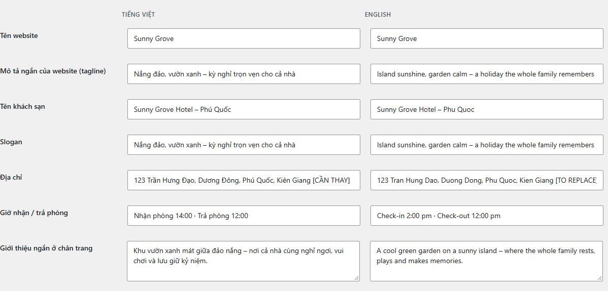

- **Chữ hiển thị (nhập cả hai ngôn ngữ):** mỗi dòng có **2 ô cạnh nhau – Tiếng Việt | English**: tên khách sạn, **slogan** (hiện to ở trang chủ), địa chỉ, giờ nhận/trả phòng, giới thiệu ở chân trang… Ô English để trống thì bản tiếng Anh hiện chữ tiếng Việt.
- **Thông tin chung (dùng cho mọi ngôn ngữ):** hotline, số Zalo, số WhatsApp (ghi kèm +84), email, link Google Maps, link nhúng bản đồ, tọa độ, khoảng giá, link mạng xã hội, bật/tắt nút chat, tự tạo ảnh WebP. Chỉ nhập **một lần**.

**Lấy link nhúng bản đồ:** mở Google Maps → tìm khách sạn → **Chia sẻ** → **Nhúng bản đồ** → sao chép đoạn mã → chỉ dán phần nằm giữa `src="` và `"` vào ô *Link nhúng bản đồ*.

Sửa ở đây là đầu trang, chân trang, trang Liên hệ, nút chat, form đặt phòng và thông tin khách sạn gửi cho Google (SEO) đều cập nhật theo.

## 3. Đổi video/ảnh banner (hero)

Mỗi trang có một **Banner video** ở đầu trang. Ảnh và video **dùng chung cho cả 2 ngôn ngữ** – đổi một lần là trang tiếng Việt và tiếng Anh cùng đổi.

1. **Trang** → di chuột vào trang cần sửa (ví dụ *Trang chủ*) → **Chỉnh sửa**. Đảm bảo nút gạt trên cùng đang ở **VI** (ở chế độ EN không đổi được ảnh/video).
2. Bấm vào vùng banner. Nếu thấy chọn nhầm chữ bên trong, bấm biểu tượng **chọn khối cha** (mũi tên lên) trên thanh công cụ nhỏ cho tới khi thanh bên phải ghi **Banner video**.
3. Ở thanh bên phải, mục **Video & ảnh nền**:
   - **Đổi ảnh poster:** ảnh hiện ngay khi trang vừa mở (nên chọn ảnh ngang, rộng ít nhất 1600px).
   - **Video cho máy tính:** bấm **Chọn video từ Thư viện** → tải video MP4 lên.
   - **Video nhẹ cho điện thoại** (tùy chọn): bản nhỏ hơn cho mạng di động.
4. Mục **Bố cục:** chỉnh độ tối lớp phủ (để chữ dễ đọc), chiều cao banner.
5. Bấm vào chữ trên banner để sửa tiêu đề/mô tả tiếng Việt; gạt sang **EN** để sửa bản tiếng Anh. *(Riêng tiêu đề lớn ở trang chủ là slogan – sửa tại Thông tin khách sạn.)*
6. Bấm **Lưu**.

**Chuẩn video tốt nhất:** MP4 (H.264), 10–20 giây, không tiếng, **dưới 5MB**, ngang 1280–1920px. Có thể nén miễn phí bằng HandBrake (preset *Web → Vimeo YouTube 720p30*) hoặc trang <https://www.freeconvert.com/video-compressor>.

Website tự động: tải trước ảnh poster (trang hiện nhanh), chỉ tải video sau khi trang hiển thị xong, **không** chạy video khi khách bật chế độ giảm chuyển động, tiết kiệm dữ liệu hoặc mạng chậm; luôn có nút tạm dừng video.

## 4. Đổi màu và font chữ

*(Cần tài khoản Quản trị viên.)*

1. **Giao diện → Trình chỉnh sửa → Phong cách** (biểu tượng nửa hình tròn).
2. **Màu sắc → Bảng màu:** bấm vào màu muốn đổi, ví dụ **Xanh ngọc biển (chính)** → chọn màu mới → **Lưu**. Toàn bộ website (nút, liên kết, bộ lọc, form đặt phòng, email) đổi theo.
   - **Vàng nắng** là màu nút “Đặt phòng”.
   - **Cát** là màu nền chính.
3. Muốn thử nhanh một bộ màu khác: trong **Phong cách → Duyệt phong cách**, chọn **Hoàng hôn**.
4. **Kiểu chữ:** chọn **Tiêu đề** hoặc **Văn bản** để đổi font/cỡ chữ. Font có sẵn: Lora (tiêu đề) và Be Vietnam Pro (nội dung), đều hỗ trợ đầy đủ tiếng Việt.
5. Lỡ tay? Bấm biểu tượng **⋮ → Đặt lại** để về mặc định.

## 5. Thêm / sửa phòng, giá, mùa cao điểm

### Sửa phòng
**Phòng** → bấm tên phòng. Bạn sẽ thấy:
- **Tiêu đề** và **nội dung mô tả** (đoạn văn, danh sách).
- **Đoạn trích** (thanh bên phải): mô tả ngắn hiện trên thẻ phòng.
- **Ảnh đại diện** (thanh bên phải): ảnh trên thẻ phòng.
- **Nhóm khách**: tích *Gia đình / Cặp đôi / Nhóm bạn* – dùng cho bộ lọc ở trang Phòng & Giá.
- **Tiện nghi trong phòng**: tích các tiện nghi (có thể thêm tiện nghi mới). Mỗi tiện nghi có **icon riêng**, chọn 1 lần tại **Phòng → Tiện nghi trong phòng** → bấm tên tiện nghi → ô **Icon** (gõ "wifi", "bồn tắm"… để tìm) → **Cập nhật**. Icon tự hiện ở thẻ phòng và trang chi tiết phòng, cả bản tiếng Anh.
- **Thứ tự** (mục *Thuộc tính trang*): số nhỏ hiện trước. 3 phòng đầu tiên hiện ở trang chủ.
- Hộp **Thông tin phòng** ở dưới cùng:

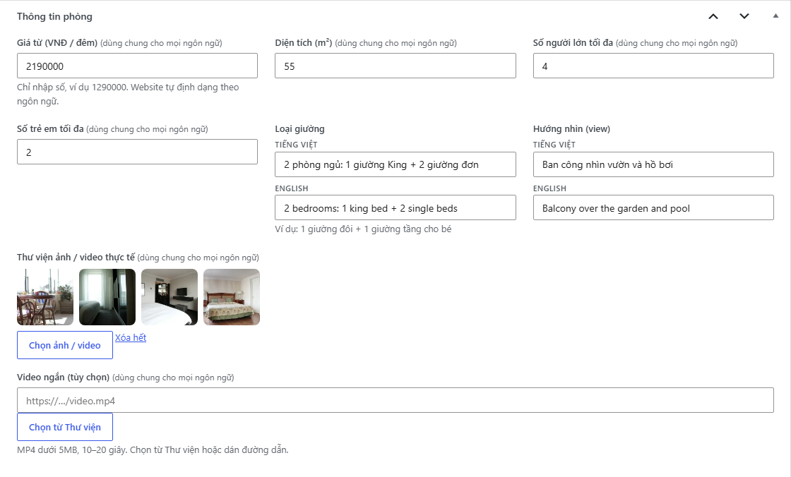

  - **Chỉ nhập một lần** (dùng chung 2 ngôn ngữ): **Giá từ** (chỉ nhập số, ví dụ `1290000`), diện tích, số người lớn/trẻ em tối đa, **Thư viện ảnh/video thực tế** (bấm *Chọn ảnh / video*, chọn được nhiều ảnh cùng lúc), video ngắn.
  - **Có 2 ô Tiếng Việt | English cạnh nhau:** loại giường, hướng nhìn.

### Thêm phòng mới
**Phòng → Thêm phòng** → điền như trên → **Đăng**. Phòng mới tự hiện ở trang Phòng & Giá, trang chủ (nếu nằm trong 3 phòng đầu) và ô chọn phòng trong form đặt phòng – ở **cả 2 ngôn ngữ**. Sau đó gạt sang **EN** để dịch tiêu đề và mô tả (mục 8).

### Giá mùa cao điểm
Website nhận **yêu cầu** đặt phòng (khách sạn gọi lại báo giá chính xác), nên không cần bảng giá theo ngày. Cách làm cho mùa cao điểm:
- **Đổi giá “Giá từ”** của phòng khi vào mùa (ví dụ Tết, hè). Chỉ có **một giá** – bản tiếng Anh tự hiện giá mới (định dạng `VND 1,290,000`).
- Thêm một dòng trong mô tả phòng, ví dụ “Giá mùa hè (01/6–31/8) từ 1.590.000đ/đêm” (nhớ dịch dòng này ở chế độ EN).
- Hoặc tạo một **Ưu đãi** cho mùa thấp điểm (mục 9) – ưu đãi tự ẩn khi hết hạn.

Chữ “Từ … đ / đêm” được định dạng tự động; muốn đổi cách hiển thị (ví dụ “/ phòng / đêm”), sửa nhãn **Giá phòng** tại **Sunny Grove → Nhãn hiển thị**.

## 6. Tiện ích

**Tiện ích** → sửa hoặc **Thêm tiện ích**. Các ô quan trọng:
- **Mô tả ngắn**, **Giờ hoạt động** (ví dụ `06:00 – 20:00 hằng ngày`) – mỗi ô có 2 ô Tiếng Việt | English.
- **Thư viện ảnh / video thực tế**: chọn nhiều ảnh/video để khách thấy rõ thực tế (dùng chung 2 ngôn ngữ).
- **Video ngắn cho thẻ**: video tự chạy (không tiếng) trên thẻ tiện ích ở trang chủ.
- **Thứ tự**: 4 tiện ích đầu tiên hiện ở trang chủ.

## 7. Thêm địa điểm Khám phá Phú Quốc

**Khám phá Phú Quốc → Thêm địa điểm**

1. Nhập **tên**, **mô tả** (nội dung), **đoạn trích** (mô tả ngắn trên thẻ), **ảnh đại diện**.
2. Hộp **Thông tin địa điểm**:
   - **Khoảng cách (km)**: ví dụ `12` hoặc `1.5` *(một lần)*.
   - **Thời gian di chuyển (phút)** và **Phương tiện** (Đi bộ / Ô tô / Xe máy) *(một lần)* → website tự hiện “20 phút đi ô tô” / “20 min by car”.
   - **Dòng so sánh vui** (tùy chọn, 2 ô VI | EN): ví dụ “Không cần tới Ý?”.
   - **Link Google Maps** *(một lần)*: mở Google Maps → tìm địa điểm → **Chia sẻ → Sao chép đường liên kết**.
3. **Nhãn lọc địa điểm** (thanh bên phải): tích *Đi bộ được*, *Dưới 30 phút đi xe*, *Phù hợp trẻ em* cho đúng.
4. **Thứ tự**: quyết định vị trí trên băng chuyền.
5. **Đăng** → địa điểm tự hiện ở băng chuyền trang chủ và trang Khám phá Phú Quốc. Sau đó gạt **EN** để dịch tên và mô tả.

## 8. Dịch sang tiếng Anh: nút gạt VI | EN

Mỗi trang/phòng/tiện ích/địa điểm/ưu đãi/bài viết chỉ có **một bản** chứa cả tiếng Việt và tiếng Anh. Bản tiếng Anh của website nằm ở địa chỉ có `/en/` phía trước, ví dụ `/en/rooms/family-garden-room/`.

### Phần nào nhập 1 lần, phần nào nhập 2 ngôn ngữ

| Chỉ nhập **một lần** (dùng chung) | Nhập **2 ngôn ngữ** |
|---|---|
| Ảnh, video, thư viện ảnh, ảnh đại diện, poster banner | Tiêu đề, tóm tắt (đoạn trích), nội dung (đoạn văn, tiêu đề, nút, danh sách, trích dẫn, chú thích ảnh, bảng…) |
| Giá, diện tích, số người, khoảng cách, thời gian di chuyển, phương tiện | Loại giường, hướng nhìn, mô tả ngắn, giờ mở cửa, dòng so sánh, điều kiện ưu đãi, nhãn ưu đãi, giá ưu đãi dạng chữ |
| Link bản đồ, link nút (trừ khi muốn link khác cho bản EN), ngày hiệu lực ưu đãi | Tên danh mục/nhãn (Gia đình, Cặp đôi…), tên mục menu |
| Bố cục trang: thứ tự block, màu, khoảng cách | Thông tin khách sạn, nhãn hiển thị, chữ trên form và email |
| Thứ tự, nhóm khách, tiện nghi đã tích | Tiêu đề SEO, mô tả SEO |

### Dịch một trang bằng nút gạt

1. Mở trang/phòng/bài cần dịch (ví dụ **Trang → Trang chủ → Chỉnh sửa**).
2. Trên thanh công cụ trên cùng có nút gạt **VI | EN**. Đang ở **VI** là sửa tiếng Việt như bình thường.

   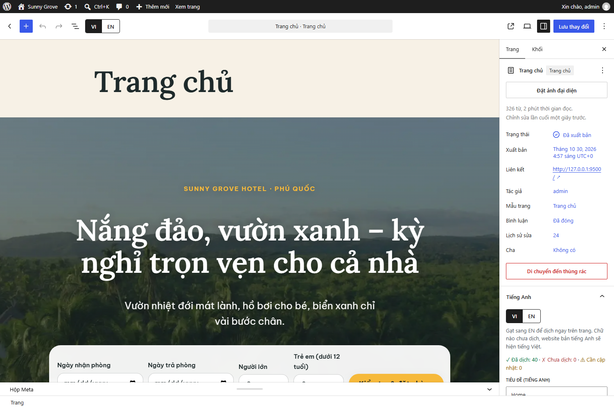

3. Bấm **EN**. Trang hiện bản tiếng Anh **ở đúng vị trí, đúng bố cục**. Bấm vào chữ nào thì gõ bản tiếng Anh của chữ đó. Ô tiêu đề bài cũng đổi sang tiêu đề tiếng Anh.

   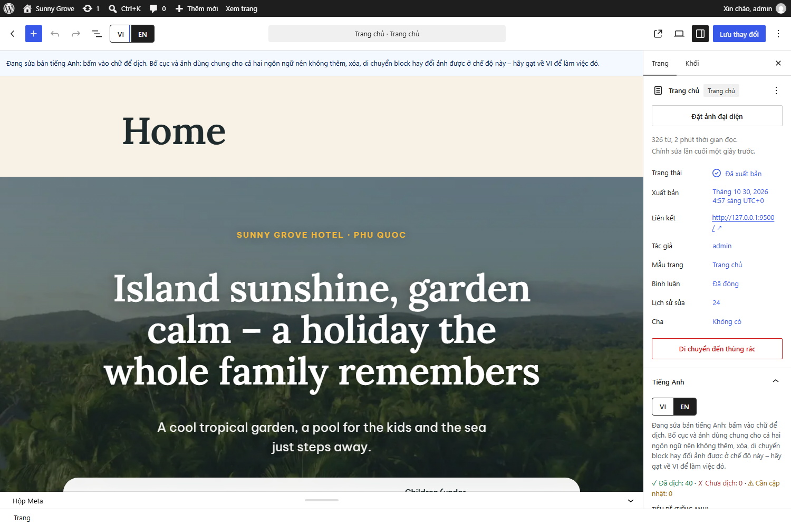

   - Block chưa dịch hiện chữ tiếng Việt **mờ** kèm nhãn **“Chưa dịch”**.
   - Ở chế độ EN **không thêm/xóa/di chuyển block và không đổi ảnh** – bố cục và ảnh dùng chung cho cả hai ngôn ngữ. Dòng nhắc màu xanh phía trên trang giải thích điều này. Muốn đổi bố cục/ảnh, gạt về **VI**.
   - Các thẻ phòng, ưu đãi, tiện ích, địa điểm trong trang hiện tên và giá tiếng Anh của từng mục – giống ngoài website. Muốn sửa chữ của một phòng, mở phòng đó trong menu **Phòng** (không sửa trong trang chủ).
4. Bấm **Lưu**. Mở `tên-miền/en/` để xem: trang tiếng Anh hiện chữ mới, trang tiếng Việt không đổi.

### Tìm và sửa phần "Chưa dịch" / "Cần cập nhật"

Khi bạn **sửa chữ tiếng Việt** của một block đã dịch, website ghi nhớ rằng bản tiếng Anh đã cũ. Gạt sang **EN** sẽ thấy nhãn vàng **“Cần cập nhật bản EN”** trên block đó:

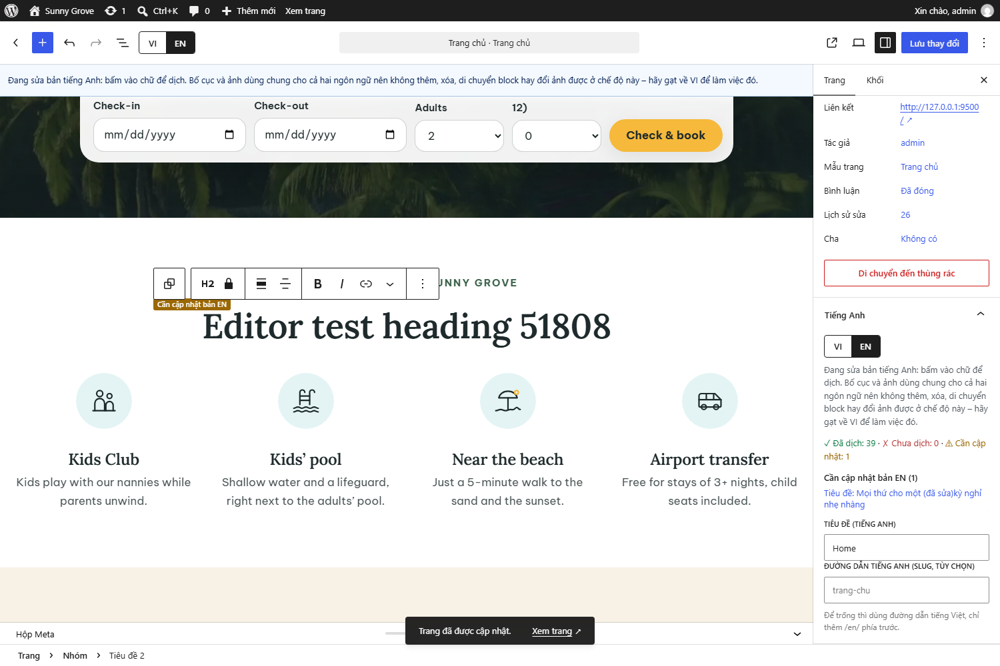

- **Thanh bên phải → mục "Tiếng Anh"** (bấm biểu tượng ô vuông góc trên phải nếu thanh bên đang ẩn, rồi chọn tab **Trang**/**Bài**): hiện số block **✓ Đã dịch · ✗ Chưa dịch · ⚠ Cần cập nhật**, kèm danh sách. **Bấm vào một dòng** để nhảy tới đúng block đó. Mục này cũng có ô **Tiêu đề (tiếng Anh)**, **Tóm tắt (tiếng Anh)** và **Đường dẫn tiếng Anh** (tùy chọn – để trống thì dùng đường dẫn tiếng Việt, chỉ thêm `/en/` phía trước).
- **Danh sách bài/trang** có cột **EN**: ✓ Đủ · ⚠ Cần cập nhật (số block) · ✗ Chưa dịch (số block). Dùng cột này để biết trang nào cần dịch tiếp.

  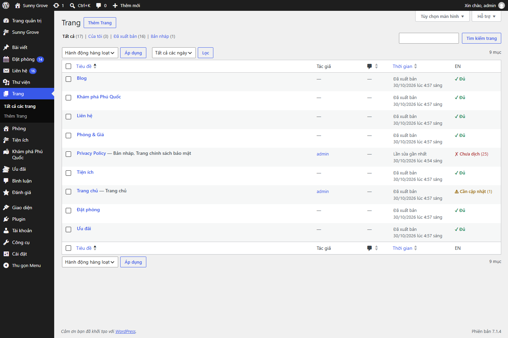

Sửa xong bản tiếng Anh của block (dù chỉ để giữ nguyên chữ cũ) thì nhãn ⚠ tự mất sau khi **Lưu**.

### Các chữ khác

- **Thông tin khách sạn, Nhãn hiển thị:** mỗi dòng có 2 ô **Tiếng Việt | English** cạnh nhau (mục 2, 14).
- **Chữ trên form và email đặt phòng/liên hệ:** **Đặt phòng → Cài đặt**, tab **Chữ & email – Tiếng Việt** và **– English** (mục 13).
- **Danh mục, nhóm khách, tiện nghi, nhãn lọc địa điểm:** vào nhóm (ví dụ **Phòng → Nhóm khách**) → bấm tên nhóm → ô **Tên (English)**. Để trống thì bản tiếng Anh hiện tên tiếng Việt.

  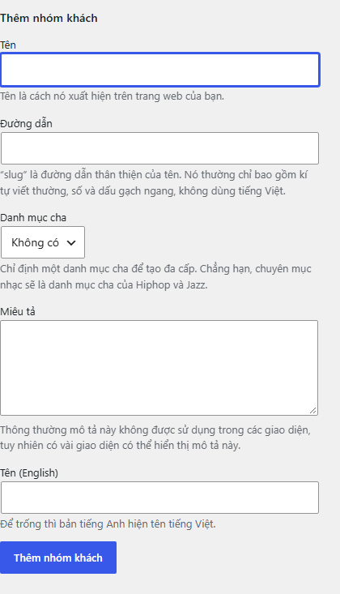

- **Menu:** mỗi mục menu có ô **Tên hiển thị (English)** (mục 14).
- **Phòng/Ưu đãi/Tiện ích/Địa điểm:** các ô chữ trong hộp thông tin có sẵn 2 ô VI | EN; tiêu đề và mô tả dịch bằng nút gạt như trên.

## 9. Tạo ưu đãi mới

**Ưu đãi → Thêm ưu đãi**
1. Tiêu đề, nội dung, đoạn trích, ảnh đại diện.
2. Hộp **Thông tin ưu đãi**: **Giá ưu đãi** (ví dụ “4.990.000đ / gia đình” hoặc “Giảm 15%”), **Giá gốc** (hiện gạch ngang), **Nhãn nổi bật** (ví dụ “-15%”), **Điều kiện áp dụng** – các ô chữ có 2 ô VI | EN; **Áp dụng từ / đến ngày** chỉ nhập một lần.
3. **Đăng** → ưu đãi hiện ở trang Ưu đãi và trang chủ (3 ưu đãi đầu theo Thứ tự) ở cả 2 ngôn ngữ. Gạt **EN** để dịch tiêu đề/nội dung.
4. **Hết hạn tự ẩn:** sau ngày “Áp dụng đến”, ưu đãi tự biến mất khỏi website (vẫn còn trong quản trị để dùng lại – chỉ cần đổi ngày).
5. Nút **“Nhận ưu đãi này”** dẫn khách tới form đặt phòng và tự điền tên ưu đãi vào ô ghi chú.

## 10. Viết bài blog

**Bài viết → Viết bài mới**
1. Nhập tiêu đề, gõ nội dung. Gõ `/` để chèn nhanh: `/tiêu đề`, `/ảnh`, `/danh sách`, `/video`…
2. Thanh bên phải: **Chuyên mục** (Cẩm nang, Ẩm thực…), **Ảnh đại diện** (bắt buộc – hiện trên thẻ bài viết), **Đoạn trích** (1–2 câu tóm tắt).
3. Ảnh trong bài: luôn điền **Văn bản thay thế (alt)** mô tả ảnh – tốt cho người khiếm thị và SEO. Ở chế độ EN có thể nhập alt và chú thích tiếng Anh.
4. **Đăng** → bài tự hiện ở trang Blog. Gạt **EN** để dịch nếu muốn khách quốc tế đọc (chưa dịch thì bản EN hiện tiếng Việt).

### Icon cho từng dòng của danh sách
Mọi danh sách gạch đầu dòng (ở trang, phòng, ưu đãi, bài viết) hiện **một icon trước mỗi dòng** thay cho dấu chấm. Dòng nào chưa chọn icon sẽ dùng **icon lá**. Cách đổi:
1. Gạt về **VI** (icon dùng chung cho cả 2 ngôn ngữ nên ở chế độ EN nút icon bị khóa).
2. Bấm vào dòng muốn đổi → trên thanh công cụ nhỏ phía trên, bấm **nút icon** (hình icon đang dùng).
3. Gõ vài chữ để tìm, tiếng Việt có dấu hoặc không dấu, hoặc tiếng Anh – ví dụ `bơi`, `boi`, `pool` đều ra **Hồ bơi** → bấm icon muốn dùng.
4. Muốn quay về icon lá: mở lại bảng và bấm **Dùng icon mặc định (lá)**. Nhớ bấm **Lưu**.

Danh sách đánh số (1, 2, 3…) vẫn giữ số, không dùng icon. Icon có màu chính của website – đổi màu chính (mục 4) thì icon đổi theo.

## 11. Quản lý yêu cầu đặt phòng

Khi khách gửi form:
- Yêu cầu được lưu ở menu **Đặt phòng** (số màu đỏ cạnh menu = số yêu cầu **Mới**).
- Khách sạn nhận email thông báo; khách nhận email “đã nhận yêu cầu” **đúng ngôn ngữ khách đang xem**.

**Quy trình xử lý:**
1. Vào **Đặt phòng → Tất cả yêu cầu**. Dùng bộ lọc **Mới / Đã liên hệ / Đã xác nhận / Đã hủy** phía trên danh sách.
2. Bấm số điện thoại để gọi (trên điện thoại) hoặc xem cách khách muốn được liên hệ (Gọi / Zalo / WhatsApp).
3. Đổi trạng thái nhanh: di chuột vào dòng → bấm **Đã liên hệ**, **Đã xác nhận** hoặc **Đã hủy**. Hoặc tích nhiều dòng → **Hành động hàng loạt → Chuyển sang: …** → **Áp dụng**.
4. Bấm tên khách để xem chi tiết: sửa ngày, phòng, số khách nếu khách đổi ý; ghi **Ghi chú nội bộ** (khách không thấy); **Gửi lại email xác nhận**.
5. Khách đặt qua điện thoại? Bấm **Thêm yêu cầu (đặt qua điện thoại)** để lưu lại cùng một chỗ.
6. **Tải danh sách (CSV/Excel)** để báo cáo hoặc lưu trữ.

**Thanh toán:** form ghi rõ *chưa cần thanh toán – trả tại khách sạn hoặc chuyển khoản đặt cọc*. Khi xác nhận với khách, nhân viên gửi thông tin chuyển khoản qua Zalo/email. (Sau này có thể gắn cổng thanh toán – cần lập trình viên.)

**Không nhận được email?** Mở chi tiết yêu cầu, dòng cuối ghi *Email cho khách sạn: Đã gửi / Gửi lỗi*. Nếu “Gửi lỗi” hoặc email vào thư rác, cần cấu hình gửi email qua SMTP (xem [docs/HOSTING.md](HOSTING.md), mục 3). Yêu cầu **không bao giờ bị mất** vì đã lưu trong quản trị.

## 12. Tin nhắn liên hệ

Form trên trang **Liên hệ** (cả bản tiếng Việt và tiếng Anh) gửi về menu **Liên hệ**:

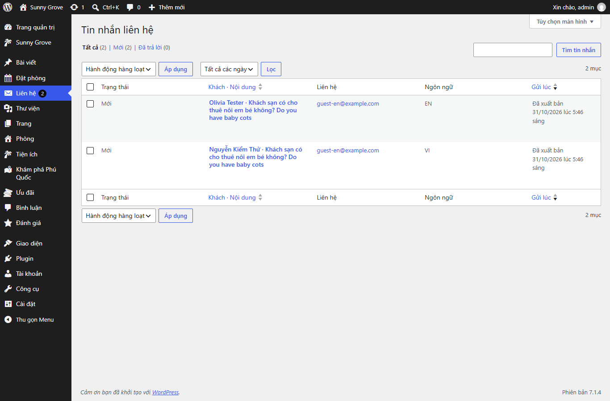

- Mỗi tin nhắn có họ tên, email, điện thoại/Zalo, nội dung, ngôn ngữ khách dùng. Số màu đỏ cạnh menu = số tin **Mới**.
- Khách sạn nhận email báo tin nhắn mới; khách nhận email cảm ơn **đúng ngôn ngữ đang xem**.
- Bấm vào tin nhắn để đọc; bấm **Trả lời qua email** để mở thư trả lời. Trả lời xong, đổi trạng thái thành **Đã trả lời** (di chuột vào dòng hoặc dùng Hành động hàng loạt).
- **Chống spam:** form tự chặn bot (gửi quá nhanh, điền ô ẩn, gửi quá nhiều lần từ một địa chỉ) – không cần mã reCAPTCHA, khách không phải bấm "Tôi không phải người máy".
- Muốn đặt form liên hệ vào trang khác: trong trình soạn thảo bấm **+** → tìm **Form liên hệ**.

## 13. Sửa chữ trên form và email

**Đặt phòng → Cài đặt**
- Tab **Chung:** email nhận thông báo (nhiều email: mỗi email một dòng), tên/email người gửi, trang chứa form, hotline/Zalo hiển thị sau khi gửi, giới hạn số khách/số đêm, **chống spam** (số lần gửi tối đa mỗi giờ từ một địa chỉ, thời gian điền tối thiểu).
- Tab **Chữ & email – Tiếng Việt** và **– English:** nhãn từng ô trên form đặt phòng và form liên hệ, thông báo cảm ơn, thông báo lỗi, **tiêu đề và nội dung email gửi khách**. Email gửi khách sạn chỉ có ở tab ngôn ngữ mặc định.

Chữ trong ngoặc nhọn như `{ten_khach}`, `{ngay_nhan}`, `{phong}`, `{ma_yeu_cau}`, `{hotline}` sẽ được thay bằng thông tin thật – **giữ nguyên ngoặc nhọn**. Danh sách đầy đủ hiện ngay trên trang cài đặt.

## 14. Menu, nút chat, nhãn hiển thị

**Menu** *(Quản trị viên)*: **Giao diện → Menu**. Có 2 menu: *Menu chính* và *Menu chân trang* – **dùng chung cho cả 2 ngôn ngữ**. Bấm vào một mục menu để mở ra, điền ô **Tên hiển thị (English)** (để trống thì bản EN dùng tên tiếng Anh của trang được liên kết, hoặc tên tiếng Việt). Link trong menu tự đổi sang `/en/…` khi khách xem bản tiếng Anh. Kéo thả để sắp xếp, tích trang bên trái → **Thêm vào menu** → **Lưu menu**. Nên giữ menu chính **tối đa 6 mục**.

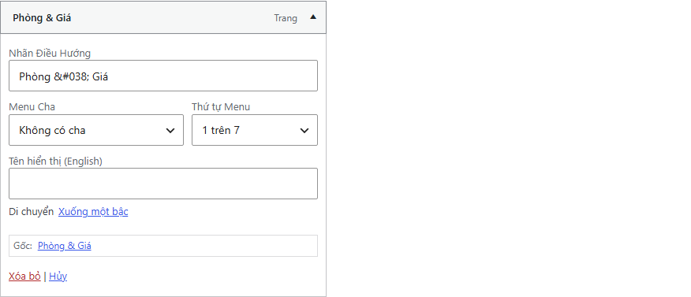

**Nút chat nổi** (Zalo, WhatsApp, Gọi): bật/tắt **từng nút** và chọn góc trái/phải tại **Sunny Grove → Thông tin khách sạn**. Số điện thoại lấy từ các ô Zalo/WhatsApp/Hotline. Nút **Gọi** chỉ hiện trên điện thoại. Nút chat không tải script bên ngoài nên không làm chậm website.

**Nhãn hiển thị:** **Sunny Grove → Nhãn hiển thị** – các chữ dùng chung như nút “Đặt phòng”, “Xem chi tiết”, “Chỉ đường”, “từ khách sạn”, trang 404, dòng bản quyền… mỗi dòng có 2 ô Tiếng Việt | English.

**Thêm khối có sẵn vào trang:** trong trình soạn thảo (chế độ **VI**) bấm **+** (góc trên trái) → tab **Mẫu** → nhóm **Sunny Grove – Khối có sẵn**: Hero video, Điểm nổi bật, Phòng tiêu biểu, Tiện ích nổi bật, Băng chuyền Khám phá, Ưu đãi, Đánh giá, Lời kêu gọi đặt phòng… Khi tạo **trang mới**, WordPress gợi ý các **Trang mẫu** dựng sẵn.

## 15. Đánh giá khách hàng

**Đánh giá → Thêm đánh giá**

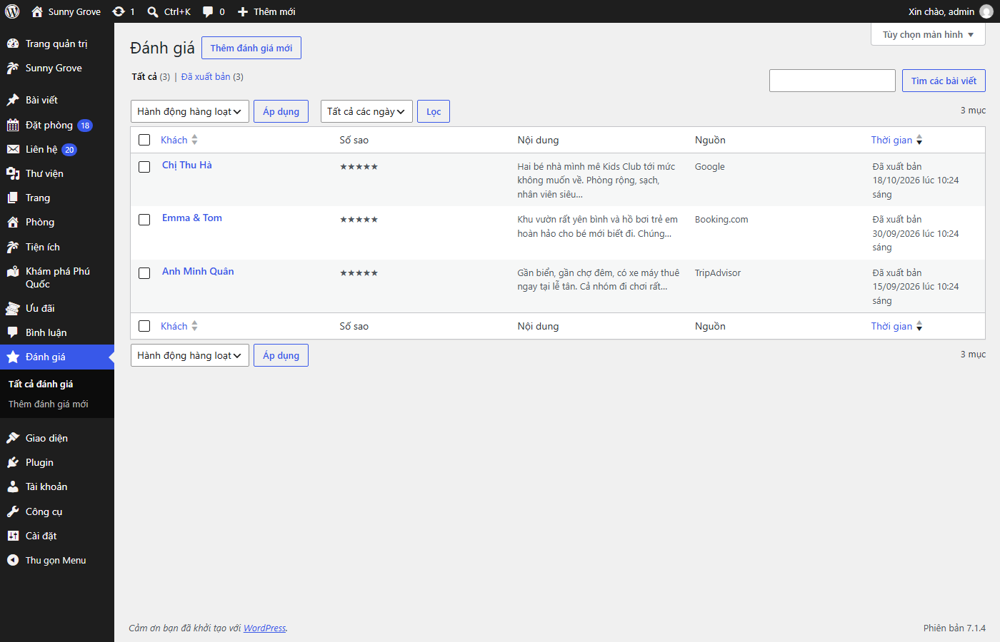

1. **Tiêu đề** = tên khách (ví dụ “Chị Lan”).
2. **Số sao** (1–5), **Nội dung đánh giá** (2 ô Tiếng Việt | English – chép nguyên văn lời khách; ô English để trống thì bản EN hiện nguyên văn tiếng Việt), **Đến từ / kiểu chuyến đi** (ví dụ “Hà Nội · gia đình 4 người” – có 2 ô VI | EN), **Nguồn** (Google, Booking.com, TripAdvisor, Khách gửi trực tiếp), **Ngày đánh giá**.
3. **Đăng**. Khối **Đánh giá khách hàng** trên trang chủ tự lấy các đánh giá mới nhất. Bấm vào khối trong trình soạn thảo để chọn số đánh giá hiển thị, chỉ lấy một nguồn, hoặc chỉ lấy đánh giá từ 4–5 sao.

Website **không nhúng widget bên ngoài** – hãy chép đánh giá thật từ Google/Booking/TripAdvisor vào đây. Xóa 3 đánh giá mẫu trước khi mở website.

## 16. SEO: hiển thị trên Google và mạng xã hội

**Từng trang/phòng/bài:** cuối trình soạn thảo có hộp **SEO – hiển thị trên Google và mạng xã hội**:

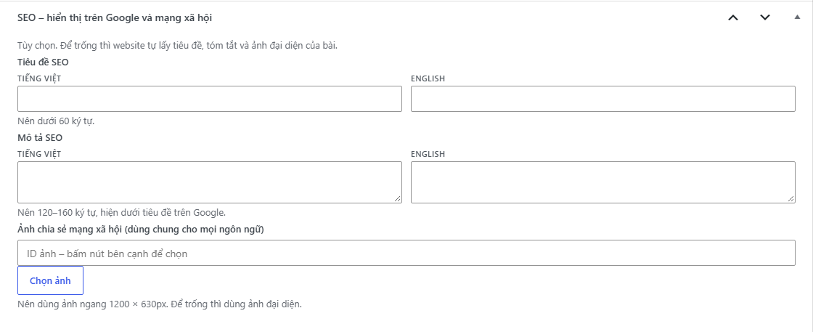

- **Tiêu đề SEO** (nên dưới 60 ký tự) và **Mô tả SEO** (120–160 ký tự) – mỗi ô có bản Tiếng Việt và English.
- **Ảnh chia sẻ mạng xã hội** (dùng chung, nên 1200 × 630px) – ảnh hiện khi chia sẻ link lên Facebook/Zalo.
- **Tất cả đều tùy chọn:** để trống thì website tự lấy tiêu đề, tóm tắt và ảnh đại diện của bài.

Website tự lo phần kỹ thuật: thẻ tiêu đề, mô tả, đường dẫn chuẩn, liên kết giữa bản VI và EN (hreflang), thông tin khách sạn/phòng/ưu đãi/địa điểm cho Google (schema), sơ đồ trang `tên-miền/wp-sitemap.xml` có cả trang tiếng Việt và tiếng Anh.

**Sunny Grove → SEO** *(chỉ quản trị viên)*:

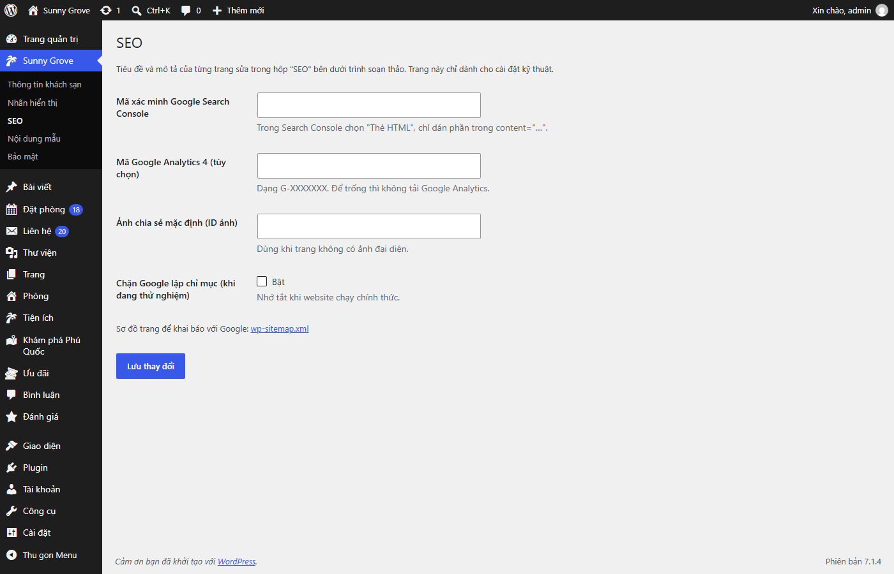

- **Mã xác minh Google Search Console:** trong Search Console chọn cách xác minh **Thẻ HTML**, chỉ dán phần mã trong `content="…"`. Sau đó khai báo sơ đồ trang `wp-sitemap.xml`.
- **Mã Google Analytics 4** (tùy chọn): dạng `G-XXXXXXX`.
- **Chặn Google lập chỉ mục (khi đang thử nghiệm):** tích khi website chưa chính thức; **nhớ bỏ tích khi mở website**.

Thông tin khách sạn gửi cho Google (tên, địa chỉ, điện thoại, giờ nhận/trả phòng, khoảng giá, tọa độ, mạng xã hội) lấy từ **Sunny Grove → Thông tin khách sạn**.

## 17. Bảo mật và xác thực 2 lớp

**Sunny Grove → Bảo mật** *(chỉ quản trị viên)*:

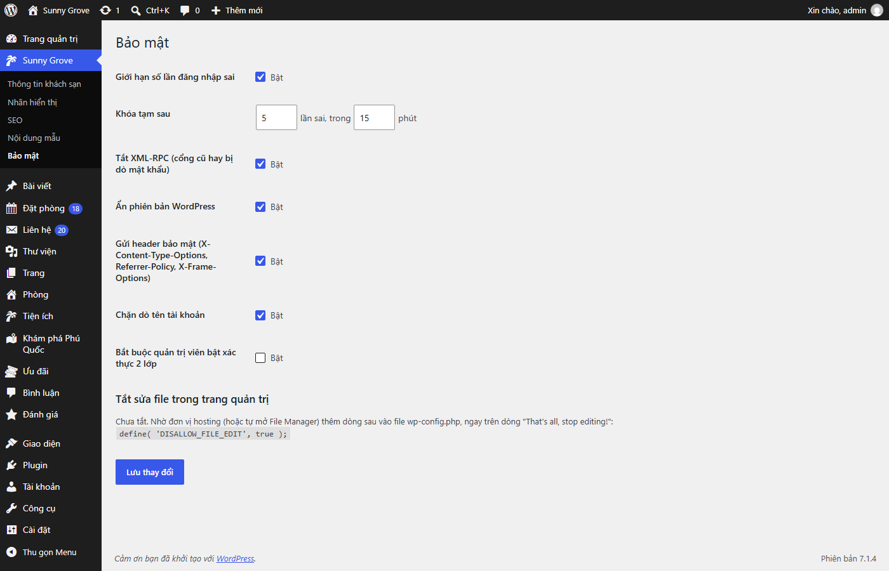

- **Giới hạn số lần đăng nhập sai:** mặc định khóa tạm 15 phút sau 5 lần sai.
- **Tắt XML-RPC**, **Ẩn phiên bản WordPress**, **Header bảo mật**, **Chặn dò tên tài khoản:** nên để bật.
- **Bắt buộc quản trị viên bật xác thực 2 lớp:** nên bật sau khi mọi quản trị viên đã cài xong.
- **Tắt sửa file trong trang quản trị:** cần thêm một dòng vào `wp-config.php` – xem [docs/HOSTING.md](HOSTING.md), mục 4.

### Bật xác thực 2 lớp cho tài khoản của bạn

Cần ứng dụng **Google Authenticator** hoặc **Microsoft Authenticator** trên điện thoại.

1. Góc trên phải → **Chỉnh sửa hồ sơ** (hoặc **Tài khoản → Hồ sơ**) → kéo xuống mục **Xác thực 2 lớp**.
2. Mở ứng dụng trên điện thoại → **Thêm (+) → Quét mã QR** → quét mã trên màn hình.

   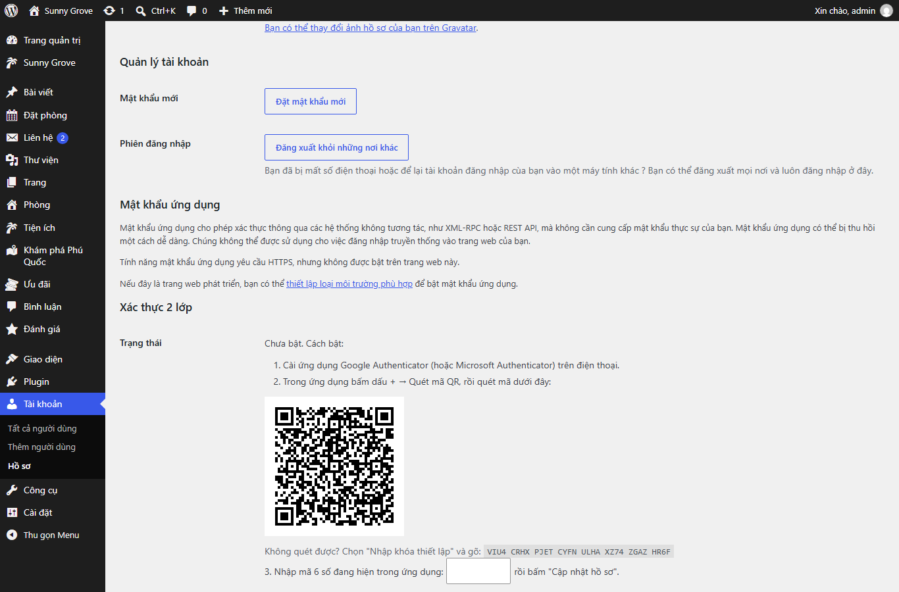

3. Nhập **mã 6 số** đang hiện trong ứng dụng → **Cập nhật hồ sơ**.
4. Màn hình hiện **10 mã khôi phục** – **chép ra giấy hoặc lưu nơi an toàn**. Mỗi mã dùng được một lần khi mất điện thoại.
5. Từ lần sau, đăng nhập xong sẽ được hỏi mã 6 số:

   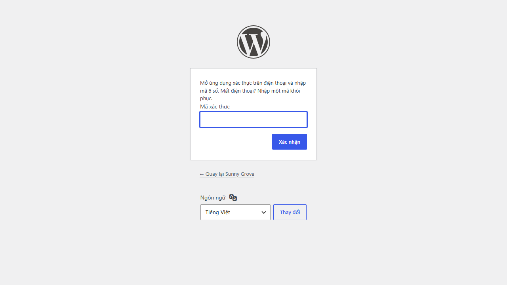

**Mất điện thoại?** Đăng nhập rồi nhập **một mã khôi phục** thay cho mã 6 số, sau đó vào Hồ sơ tắt và bật lại xác thực 2 lớp với điện thoại mới. Mất cả mã khôi phục: nhờ quản trị viên khác tắt giúp, hoặc nhờ hosting thêm `define( 'SG_DISABLE_2FA', true );` vào `wp-config.php` để tạm tắt (nhớ xóa dòng này sau khi vào được).

## 18. Tạo tài khoản cho nhân viên

**Tài khoản → Thêm mới** → điền email, tên đăng nhập → **Vai trò: Biên tập viên khách sạn** → **Thêm người dùng mới**.

Biên tập viên khách sạn **được**: sửa trang, bài viết, phòng, tiện ích, địa điểm, ưu đãi, đánh giá, ảnh và **bản dịch tiếng Anh**; xử lý yêu cầu đặt phòng và tin nhắn liên hệ; sửa Thông tin khách sạn, Nhãn hiển thị, Cài đặt đặt phòng; nhập Tiêu đề/Mô tả SEO của từng bài.
**Không được**: cài/xóa plugin, đổi theme, sửa màu/font/menu toàn site, quản lý tài khoản, **cài đặt SEO kỹ thuật** (Search Console, Analytics, chặn Google), **cài đặt Bảo mật**, cài đặt hệ thống.

## 19. Sao lưu, cache và việc với hosting

Website không tự sao lưu và không tự cache trang – hai việc này dùng tính năng có sẵn của hosting, ổn định hơn. Xem hướng dẫn từng bước trong **[docs/HOSTING.md](HOSTING.md)**:
- **Bật cache** (LiteSpeed hoặc Nginx) để website nhanh.
- **Bật sao lưu tự động hằng ngày** và thử khôi phục một lần.
- **Email qua SMTP** để email đặt phòng không vào thư rác.

**Xuất dữ liệu thủ công** (nên làm trước mỗi thay đổi lớn): **Công cụ → Xuất → Toàn bộ nội dung → Tải xuống tập tin xuất**. File này chứa trang, bài, phòng, ưu đãi, tin nhắn… gồm cả chữ tiếng Việt và tiếng Anh.

## 20. Danh sách kiểm tra trước khi mở website

- [ ] **Sunny Grove → Thông tin khách sạn:** hotline, Zalo, WhatsApp, email, địa chỉ, bản đồ, tọa độ thật (cả ô English).
- [ ] **Đặt phòng → Cài đặt:** email nhận thông báo thật; email người gửi cùng tên miền; thử gửi 1 yêu cầu ở `/` và 1 ở `/en/`, 1 tin nhắn liên hệ mỗi ngôn ngữ.
- [ ] Email gửi qua SMTP, gửi thử vào Gmail không nằm trong thư rác ([HOSTING.md](HOSTING.md) mục 3).
- [ ] Thay giá phòng, giá ưu đãi, giá dịch vụ có ghi [CẦN THAY].
- [ ] Thay toàn bộ **ảnh và video minh họa** bằng hình thật của khách sạn (mục 3, 5, 6, 7) – chỉ cần đổi một lần.
- [ ] Thay 3 **đánh giá mẫu** bằng đánh giá thật (mục 15).
- [ ] Xóa ưu đãi mẫu “Hè rực rỡ 2025” (ví dụ ưu đãi hết hạn).
- [ ] Cột **EN** ở danh sách Trang/Phòng/Ưu đãi… không còn ✗ hay ⚠ ở trang quan trọng (mục 8).
- [ ] Mọi quản trị viên đã bật **xác thực 2 lớp**, rồi bật *Bắt buộc quản trị viên bật xác thực 2 lớp* (mục 17).
- [ ] Hosting: cache, sao lưu tự động, `DISALLOW_FILE_EDIT` ([HOSTING.md](HOSTING.md)).
- [ ] **Sunny Grove → SEO:** bỏ tích *Chặn Google lập chỉ mục*; dán mã Search Console; khai báo `wp-sitemap.xml`.
- [ ] Thử website trên điện thoại ở cả `/` và `/en/`: menu, nút VI | EN, nút Đặt phòng, nút Zalo/WhatsApp/Gọi, form.
- [ ] Chạy kiểm tra tốc độ tại <https://pagespeed.web.dev> (mục tiêu điểm Mobile ≥ 80).
